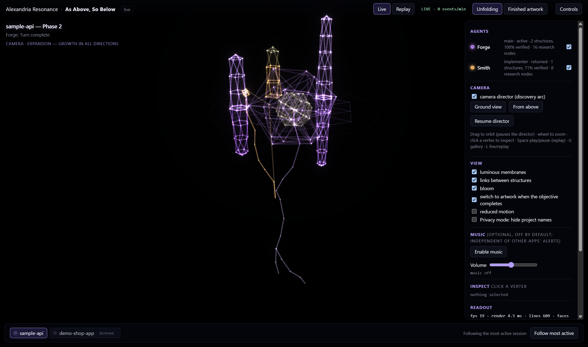
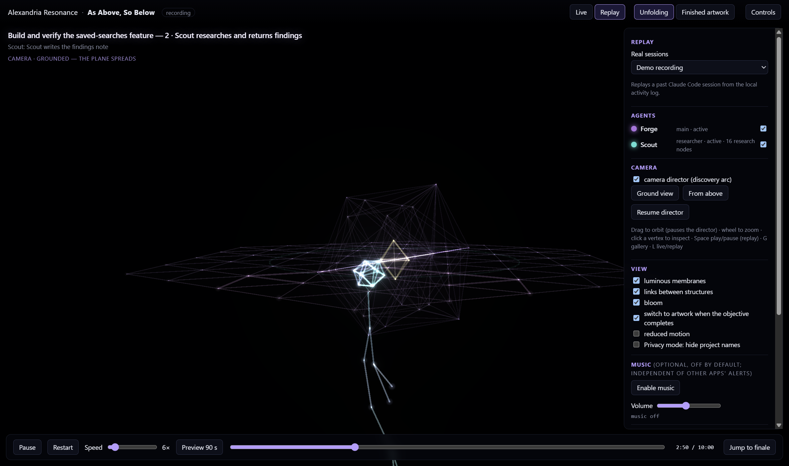
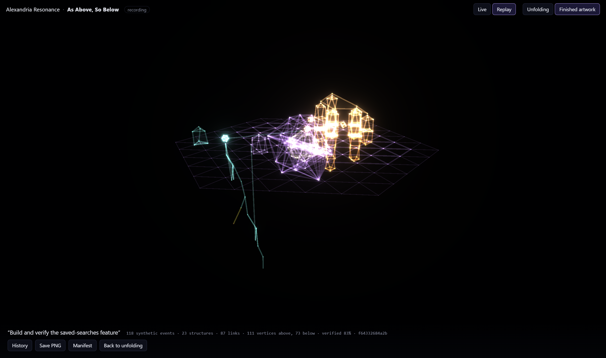

# Alexandria Resonance

**Alexandria Resonance** is a free, immersive generative-art application by Alexandria Ltd. It turns real coding
activity from Claude Code (sessions, subagents, tool calls, tests, commits) into an evolving 3D artwork with original
generative music: **As Above, So Below**. A reflection plane divides the scene. Crystals grow above it as work is
built and verified, roots grow below it as the code is read and researched, and 4D geometry breathes in the
background.

Resonance is an artistic interpretation of observed events. It does not depict anyone's thoughts, and it never
reads prompts, code or file contents. Everything runs locally on your machine.

## Screenshots

| Live | Replay | Artwork |
|---|---|---|
<!-- Screenshots use synthetic sessions (demo-shop-app, sample-api) and the bundled synthetic recording; no real activity. -->
|  |  |  |

## Features

- **Live mode**: each running Claude Code session becomes its own universe, fed by a local, content-free collector log.
- **Replay mode**: plays the bundled synthetic demo recordings, or any session found in your own collector log. It
  works without Claude Code or the collector.
- **Session focus and pinning**: the page follows the most active session, or you pin one by clicking its chip.
- **Dormant sessions**: after 20 minutes without activity a session freezes and dims, and wakes on its next event.
- **Privacy mode**: hides project names (shown as Session A, B, ...) everywhere, including the manifest.
- **Music**: original, procedurally generated, off by default, with mute and volume. No samples or copyrighted material.
- **Camera director**: a camera that moves through grounded, curiosity, revelation, expansion and completion phases.
- **Forge session** (`packages/forge/session.html`): a demonstration session with workshop heat and verification states.
- **Geometry laboratory** (`packages/forge/lab.html`): N-dimensional rotations, Platonic solids, the 16-, 24- and
  600-cell, projections.
- **Earlier prototypes**: a Canvas 2D visualizer (`packages/visualizer/`) and a music prototype
  (`packages/audio/index.html`).

Details are in [`docs/`](docs/): [Live mode](docs/LIVE_MODE.md), [The Forge](docs/FORGE.md),
[Music](docs/MUSIC_ARCHITECTURE.md), [Visual mapping](docs/VISUAL_MAPPING.md), [Architecture](docs/ARCHITECTURE.md),
[Privacy and licensing](docs/PRIVACY_SECURITY_LICENSING.md), [Roadmap](docs/ROADMAP.md).

## Requirements

- Windows 11. Verified so far: the browser version and the x64 desktop build (also running under x64 emulation on
  Windows on ARM). A native ARM64 desktop build is supported by the tooling but not yet verified for Resonance. The
  web pages are plain ES modules and may work on other platforms, which are untested.
- Node.js 22 or newer.
- A browser with WebGL (the desktop app brings its own).
- For **Live mode**: Claude Code and the Alexandria collector (see below). Replay works without them.

## Install and run from source

```
npm install
npm start          # local server on http://127.0.0.1:4350 (set VZ_PORT to change)
npm run desktop    # Electron desktop window (loads the same local server)
npm test           # unit and integration tests
```

Open http://127.0.0.1:4350 for the main page. Other pages: `/packages/forge/session.html`,
`/packages/forge/lab.html`, `/packages/visualizer/`, `/packages/audio/index.html`.

## The collector (Live mode)

Live mode reads a local log, `~/.claude/eta/events.jsonl` (override with `VZ_HOOK_LOG`), written by a small Claude
Code hook, `collector/eta-hook.mjs`. The collector is shared with Alexandria Scoreboard and is installed once per
machine. It records only timestamps, event kinds, ids, tool names and durations, plus pass/fail counts for test
runs. It never writes prompts, tool inputs or outputs, or file contents. Resonance only reads the log.

**If a collector entry already exists** in `~/.claude/settings.json`, preview the missing hooks, then apply:

```
node tools/install-collector-v3.mjs            # dry run: shows what would change
node tools/install-collector-v3.mjs --apply    # backs up first, only adds missing hooks
```

The installer currently needs an existing collector entry under `hooks.Stop`, so it cannot do a first-time install.

**First-time manual install:**

1. Copy `collector/eta-hook.mjs` to `~/.claude/eta/eta-hook.mjs` (create the folder).
2. Merge the `hooks` section of `collector/hooks.settings-fragment.json` into your `~/.claude/settings.json`.
3. Replace the placeholder path `~/.claude/eta/eta-hook.mjs` in each `command` with the **absolute path of your own
   copy**, for example `node "<your home folder>/.claude/eta/eta-hook.mjs"`, written as an absolute path. The placeholder will not be
   expanded for you.
4. Restart Claude Code.

Read the hook and the settings fragment before installing; they are short. Claude Code's own protections may stop an
agent from editing your settings, so make these changes yourself.

## Privacy

- No network connections are made by any package in this repository. The local server binds to `127.0.0.1` only,
  sends no CORS headers and checks the `Host` header.
- Resonance does not read prompts, code or file contents, and does not read Claude Code transcripts in Live mode.
- Crystals stand for implementation stretches, not files. Project names can be hidden with privacy mode.
- Exported images and manifests contain what you see on screen. Sharing one is your decision.

See [docs/PRIVACY_SECURITY_LICENSING.md](docs/PRIVACY_SECURITY_LICENSING.md).

## Development status

Alexandria Resonance 0.1.0 is a **development preview**. The source is available, but there are **no official
binaries yet**. Local unsigned builds (`npm run dist:zip`, `npm run dist:dir`) are development builds and may be
blocked by Windows Smart App Control or Code Integrity, because they are not code-signed. Future production
releases are intended to be signed; until then, run from source.

## Independence from Alexandria Scoreboard

Resonance does not need, launch or link to Alexandria Scoreboard or any other application. The two share only an
event protocol. `collector/`, `packages/event-engine/`, `packages/taxonomy/`, `fixtures/` and
`tools/install-collector-v3.mjs` are a vendored copy of that protocol. Its version is recorded in
`PROTOCOL_VERSION.json`, and `npm test` fails if the vendored files drift from it.

## Licence

Licensed under the [Apache License, Version 2.0](LICENSE). See [NOTICE](NOTICE) and
[THIRD_PARTY_NOTICES.md](THIRD_PARTY_NOTICES.md) for third-party components (Three.js, Electron, Tree-sitter).

Copyright 2026 Alexandria Ltd.
